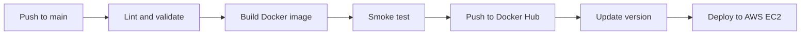

# DevOps Intern Task

A complete DevOps workflow for a simple Flask application. The project demonstrates Docker-based containerization, automated validation with GitHub Actions, Docker Hub image publishing, automatic versioning, deployment to an AWS EC2 instance, and Bash-based system health monitoring.

## Table of Contents

- [Project Overview](#project-overview)
- [Repository Structure](#repository-structure)
- [Application Endpoints](#application-endpoints)
- [Run Locally](#run-locally)
- [Docker Implementation](#docker-implementation)
- [CI/CD Pipeline](#cicd-pipeline)
- [GitHub Configuration](#github-configuration)
- [AWS EC2 Deployment](#aws-ec2-deployment)
- [System Health Monitoring](#system-health-monitoring)
- [Deployment Verification](#deployment-verification)
- [Key Features](#key-features)

## Project Overview

The application is a minimal Flask service with two HTTP endpoints:

- `/` — returns the application status.
- `/health` — returns a health-check response.

The CI/CD workflow is designed to run when code is pushed to the `main` branch. It performs code and configuration checks, builds and smoke-tests the Docker image, publishes the image to Docker Hub, updates the application version, and deploys the image to an AWS EC2 instance over SSH.

## Repository Structure

```text
.
├── app.py
├── requirements.txt
├── Dockerfile
├── docker-compose.yml
├── .dockerignore
├── VERSION
├── system_health.sh
├── docs/
│   └── workflow.svg
└── .github/
    └── workflows/
        └── ci.yml
```

## Application Endpoints

| Endpoint | Description |
|---|---|
| `GET /` | Returns the application status |
| `GET /health` | Returns the health-check status |

### Example response: `/`

```json
{
  "message": "Hello from DevOps Intern Task!",
  "status": "running"
}
```

### Example response: `/health`

```json
{
  "status": "healthy"
}
```

## Run Locally

### Prerequisites

- Docker Engine
- Docker Compose v2

### Start the application

```bash
docker compose up --build
```

The application is exposed on port `8080`.

### Verify the endpoints

```bash
curl http://localhost:8080/
curl http://localhost:8080/health
```

### Stop the application

```bash
docker compose down
```

## Docker Implementation

The Docker image incorporates the following practices:

- **Multi-stage build:** separates dependency installation from the runtime image.
- **Lightweight base image:** uses `python:3.12-slim`.
- **Non-root execution:** runs the application as an unprivileged user.
- **Layer caching:** installs dependencies before copying application source code.
- **Container health check:** checks application availability through `GET /health`.
- **Security hardening:** configures a read-only filesystem, drops Linux capabilities, and enables `no-new-privileges`.
- **Production application server:** uses Gunicorn rather than Flask's development server.
- **Dependency management:** pins application dependencies.
- **Build context control:** uses `.dockerignore` to exclude unnecessary files.

## CI/CD Pipeline

The GitHub Actions workflow is located at:

```text
.github/workflows/ci.yml
```

The pipeline is configured to run on pushes to the `main` branch.

### Workflow



The repository also includes a workflow diagram at [`docs/workflow.svg`](docs/workflow.svg).

### Pipeline stages

#### 1. Lint and validate

The workflow uses:

- `flake8` — Python code linting.
- `shellcheck` — Bash script analysis.
- `hadolint` — Dockerfile linting.

#### 2. Build and smoke test

The workflow builds the Docker image and runs a smoke test against the `/health` endpoint.

#### 3. Publish the image

After validation, the image is published to Docker Hub with these tags:

| Tag | Purpose |
|---|---|
| `latest` | Latest published image |
| `v<version>` | Version-specific image |
| `<commit-sha>` | Image associated with a Git commit |

Example image tags:

```text
ponkoog/devops-task:latest
ponkoog/devops-task:v1.0.1
ponkoog/devops-task:209fd57
```

#### 4. Automatic versioning

The workflow updates the application version after a successful build, using the `VERSION` file.

#### 5. Deploy to EC2

After publishing the image, the deployment stage:

1. Connects to the EC2 instance through SSH.
2. Pulls the published Docker image.
3. Stops the previous application container.
4. Starts the new application container.
5. Checks the application health endpoint.

## GitHub Configuration

Configure the following repository secrets under **Settings → Secrets and variables → Actions → Secrets**.

| Secret | Description |
|---|---|
| `DOCKERHUB_USERNAME` | Docker Hub username |
| `DOCKERHUB_TOKEN` | Docker Hub access token |
| `VPS_HOST` | Public IP address or DNS name of the EC2 instance |
| `VPS_USER` | SSH username on the EC2 instance |
| `VPS_SSH_KEY` | Private SSH key used by GitHub Actions |

Add the following repository variable under **Settings → Secrets and variables → Actions → Variables**.

| Variable | Value | Description |
|---|---|---|
| `DEPLOY_ENABLED` | `true` | Enables the deployment stage |

Do not commit credentials, private keys, or tokens to the repository.

## AWS EC2 Deployment

The deployment target is an Ubuntu-based AWS EC2 instance with Docker Engine installed.

### Deployment flow

```text
Developer pushes code to main
            |
            v
      GitHub Actions
            |
            v
      Lint and validate
            |
            v
      Build and smoke test
            |
            v
       Docker Hub
            |
            v
      SSH deployment
            |
            v
         AWS EC2
```

### Infrastructure

- AWS EC2
- Ubuntu
- Docker Engine
- GitHub Actions
- Docker Hub

### Security group ports

| Port | Purpose |
|---|---|
| `22` | SSH — restrict access to trusted source IPs |
| `80` | HTTP |
| `443` | HTTPS |

## System Health Monitoring

The repository includes `system_health.sh`, a Bash script that monitors basic server resources:

- CPU usage
- Memory usage
- Disk usage

The script records monitoring results in:

```text
health_log.txt
```

### Run the script manually

```bash
chmod +x system_health.sh
./system_health.sh
```

Example log entry:

```text
[2026-11-06 10:30:00] CPU: 4.2% | Memory: 37.5% | Disk: 52%
```

### Disk usage warning

When disk usage exceeds `80%`, the script prints and logs a warning:

```text
[WARNING] Disk space high!
```

### Schedule the script with cron

To run the script every five minutes, add the following entry to the crontab:

```cron
*/5 * * * * /path/to/system_health.sh
```

Replace `/path/to/system_health.sh` with the absolute path to the script. Ensure the cron user has permission to execute it and write to the log file.

## Deployment Verification

After deployment, connect to the EC2 instance and check the running container:

```bash
docker ps
```

The expected deployment should show the application container as healthy, with host port `80` mapped to container port `8080`.

Check the health endpoint locally on the EC2 instance:

```bash
curl http://localhost/health
```

Expected response:

```json
{
  "status": "healthy"
}
```

## Key Features

- Flask application with status and health endpoints
- Multi-stage Docker build
- Non-root container execution
- Docker security hardening
- Docker Compose support
- GitHub Actions CI/CD workflow
- Python, shell, and Dockerfile linting
- Docker image smoke testing
- Docker Hub publishing
- Automatic application versioning
- SSH-based AWS EC2 deployment
- Container health checks
- Bash-based CPU, memory, and disk monitoring
- Cron-compatible monitoring automation

## Conclusion

This project demonstrates an end-to-end DevOps workflow, from a code push to container image publication and deployment on AWS EC2. It brings together application containerization, automated validation, image versioning, deployment automation, and basic server monitoring in one repository.
