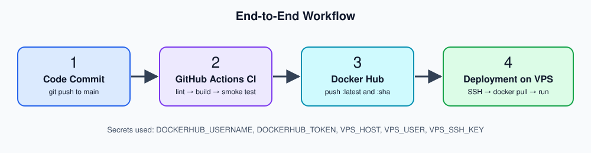
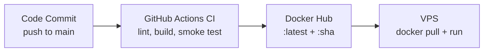

# DevOps  Task

A minimal Flask app, containerized with Docker, built and published by GitHub Actions, plus a Bash health-check script.

## Repository structure

```
.
├── app.py                      # Flask app (GET / -> JSON)
├── requirements.txt
├── Dockerfile                  # multi-stage, slim, non-root
├── docker-compose.yml          # runs app on port 8080
├── system_health.sh            # CPU / memory / disk logger
├── docs/workflow.svg           # CI/CD diagram
└── .github/workflows/ci.yml    # CI pipeline
```

## 1. Run the app

Requires Docker with Compose v2.

```bash
docker compose up --build        # or: docker-compose up --build
```

Test it:

```bash
curl http://localhost:8080/
# {"message":"Hello from DevOps Intern Task!","status":"running"}
```

Stop: `docker compose down`

### Docker best practices used
- **Multi-stage build**: dependencies are built into wheels in a builder stage; the final image has no build tooling.
- **Lightweight base**: `python:3.12-slim`.
- **Non-root**: runs as the unprivileged `app` user.
- **Layer caching**: `requirements.txt` is copied before source code.
- **Hygiene**: `.dockerignore`, pinned dependencies, `HEALTHCHECK`, gunicorn instead of Flask's dev server, and in Compose a read-only filesystem, all capabilities dropped and `no-new-privileges`.

## 2. CI/CD pipeline





Workflow: `.github/workflows/ci.yml`, triggered on every push to `main`.

1. **lint**: flake8 (Python), shellcheck (Bash), hadolint (Dockerfile).
2. **build-and-push**: builds the image to verify it, smoke-tests `GET /`, logs in to Docker Hub, then pushes `:latest` and `:<commit-sha>`.
3. **deploy** (optional): SSHes into a VPS and runs the new image. Runs only if the repo variable `DEPLOY_ENABLED=true`.

### Required GitHub secrets
| Secret | Purpose |
|---|---|
| `DOCKERHUB_USERNAME` | Docker Hub username |
| `DOCKERHUB_TOKEN` | Docker Hub access token (Account Settings → Security) |
| `VPS_HOST`, `VPS_USER`, `VPS_SSH_KEY` | Only for the optional deploy job |

## 3. Health script

```bash
chmod +x system_health.sh
./system_health.sh
cat health_log.txt
```

Each run appends a line such as:

```
[2026-11-05 10:30:00] CPU: 4.2% | Memory: 37.5% | Disk: 52%
```

If root disk usage is above 80%, it prints `[WARNING] Disk space high!` and also records it in the log.

To run it every 5 minutes with cron: `*/5 * * * * /path/to/system_health.sh`

## 4. How would you deploy this container to AWS (EC2 or any VPS)?

- **Provision and secure**: launch a small EC2 instance (Ubuntu, t3.micro), install Docker, and use a security group that allows only 22 (restricted to my IP) and 80/443. Use an IAM role or SSH key, never hard-coded credentials.
- **Deploy the CI-built image**: the pipeline already pushes the image to Docker Hub, so the server only needs `docker pull <user>/devops-intern-task:latest` and `docker run -d --restart unless-stopped -p 80:8080 ...`. The optional `deploy` job automates this over SSH, and tagging by commit SHA allows easy rollback.
- **Harden and operate**: put Nginx or an ALB in front for HTTPS (Let's Encrypt or ACM), use the container `HEALTHCHECK` for monitoring, and ship logs to CloudWatch. For scale, move to ECS Fargate or Kubernetes with the same image.
